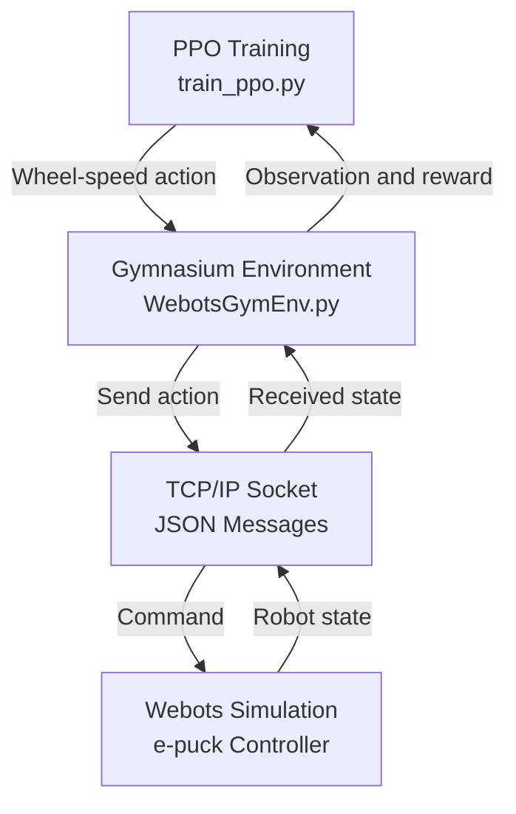

# PPO-Based Robot Navigation in Webots

## 1. Project Overview

This project investigates the use of Proximal Policy Optimization (PPO), a reinforcement learning algorithm, to train an e-puck mobile robot to navigate toward a target in the Webots simulation environment.

The project uses a custom Gymnasium environment to connect the Python training code with the Webots robot simulation.

The current implementation represents a single-agent PPO baseline. Its performance must be evaluated experimentally before drawing conclusions about navigation success or obstacle avoidance

The following diagram illustrates the interaction between the PPO training script, the custom Gymnasium environment, and the Webots simulation.



*Figure 1. High-level architecture of the PPO–Webots interaction loop.*

## 2. Project Objectives

- Implement a PPO-based training pipeline for a simulated mobile robot.
- Connect the Webots simulation to a custom Gymnasium environment.
- Define observations, wheel-speed actions, and a reward function for navigation.
- Save trained models and normalization statistics.
- Establish a reproducible baseline for future experiments.

## 3. Software and Tools

| Software / Library | Version / Requirement | Purpose |
|---|---|---|
| Webots | R2025a | Robot simulation |
| Python | 3.10 | Training and environment integration |
| PyTorch | `torch>=2.8.0` | Neural network computation |
| Gymnasium | `gymnasium>=1.3.0` | Reinforcement learning environment interface |
| Stable-Baselines3 | `stable-baselines3>=2.9.0` | PPO implementation and training |
| NumPy | `numpy>=1.26.0,<2.0.0` | Numerical computation |
| Matplotlib | `matplotlib>=3.5.0` | Plotting and visualization |

### Installation

Install the Python dependencies using:

```bash
python -m pip install "torch>=2.8.0" "gymnasium>=1.3.0" "stable-baselines3>=2.9.0" "numpy>=1.26.0,<2.0.0" "matplotlib>=3.5.0"
```

Python 3.10 is the specified Python version for this project. Webots is installed separately.

### Reproducibility Note

The listed package constraints specify the required version ranges, not necessarily the exact versions installed during the original experiments. For reproducibility, the resolved package versions should be recorded from the Python environment used for training.

- Webots download: https://cyberbotics.com/#download
- Python 3.10: https://www.python.org/downloads/release/python-3100/

## 4. Environment and Robot

The simulated robot is an e-puck mobile robot. The Python environment communicates with the Webots controller through a local TCP/IP socket using JSON messages.

The observation vector contains 10 values:

1. Robot x-coordinate.
2. Robot y-coordinate.
3. Target x-coordinate.
4. Target y-coordinate.
5. Obstacle x-coordinate.
6. Obstacle y-coordinate.
7. Distance to the target.
8. Distance to the obstacle.
9. Angular difference between the robot heading and the target direction.
10. Robot yaw angle.

The action consists of two continuous values representing the left and right wheel velocities. The action space is bounded by approximately -7.536 to +7.536 rad/s for each wheel.

Although the Webots controller reads eight proximity sensors, their readings are not included in the current 10-value observation vector.

## 5. Training Configuration

The training script uses PPO from Stable-Baselines3 with an MLP policy.

| Parameter | Configured value |
|---|---:|
| Algorithm | PPO |
| Policy | MlpPolicy |
| Training timesteps per run | 200,000 |
| Random seed | 42 |
| Learning rate | 0.0003 |
| Rollout steps (`n_steps`) | 2,048 |
| Batch size | 256 |
| Training epochs (`n_epochs`) | 10 |
| Discount factor (`gamma`) | 0.995 |
| GAE parameter (`gae_lambda`) | 0.95 |
| Clipping range | 0.2 |
| Entropy coefficient | 0.001 |
| Checkpoint frequency | Every 20,000 callback steps |

Observation and reward normalization are configured using Stable-Baselines3 `VecNormalize`.

These values describe the configuration in the training script. They do not, by themselves, establish the final performance of the trained policy.

## 6. Reward Function

The reward function encourages the robot to reach the target and make progress toward it.

- **Target reached:** A reward of +10 is given when the target is reached for the first time in the current approach.
- **Progress toward target:** The reward includes 100 times the reduction in distance to the target since the previous step.
- **Heading alignment:** A term of 0.1 times the cosine of the angular difference encourages the robot to face the target.
- **Obstacle proximity:** A penalty is applied when the robot is closer than 0.20 m to the defined obstacle.
- **Boundary violation:** A penalty of 5 is applied when the robot's distance from the environment origin exceeds 0.8 m.

The reward function is a design choice and must be assessed through controlled experiments and evaluation metrics.
**Case 1 — First registered target arrival**

When the target distance is less than the waypoint radius:

$$
R_t = 10
$$

if \(d_t < 0.1\) and `has_reached` is `False`.

$$
R_t = 100p_t + 0.1\cos(\Delta\theta_t) - P_o(t) - P_b(t)
$$

## 6. Reward Function

The reward function is implemented in `WebotsGymEnv.py`, within the `_compute_reward()` method. It evaluates the robot's progress toward the target, its heading alignment, its proximity to the defined obstacle, and its distance from the environment origin. A separate reward is assigned when the robot reaches the target region.

### 6.1. Overall Reward Function

Let \(R_t\) denote the reward at time step \(t\). The reward is calculated according to the following conditions.

**Case 1 — First registered target arrival**

$$
R_t = 10
$$

if \(d_t < r_g\) and `has_reached` is `False`.

**Case 2 — Target arrival already registered**

$$
R_t = 0
$$

if \(d_t < r_g\) and `has_reached` is `True`.

**Case 3 — Target not reached**

$$
R_t = 100p_t + 0.1\cos(\Delta\theta_t) - P_o(t) - P_b(t)
$$

if \(d_t \geq r_g\).

The target radius is defined as

$$
r_g = 0.1 \text{ m}
$$

### 6.2. Reward Components

**1. Progress Toward the Target**

The progress term measures the change in distance between consecutive steps:

$$
p_t = d_{t-1} - d_t
$$

If the previous target distance is unavailable, the progress term is set to zero:

$$
p_t = 0
$$

A positive value of \(p_t\) indicates that the robot has moved closer to the target, whereas a negative value indicates that the distance has increased. The progress contribution to the reward is \(100p_t\).

**2. Heading Alignment**

The heading alignment contribution is defined as

$$
R_{\mathrm{heading}} = 0.1\cos(\Delta\theta_t)
$$

where \(\Delta\theta_t\) is the normalized angular difference between the robot's heading and the direction toward the target. The cosine term provides a positive contribution when the robot faces toward the target and a negative contribution when it faces away from it.

**3. Obstacle Proximity Penalty**

The obstacle penalty is applied when the distance to the defined obstacle is less than \(0.20\) m:

$$
P_o(t) =
\begin{cases}
0.125 \dfrac{0.20-d_o(t)}{0.20}, & d_o(t)<0.20 \\
0, & d_o(t)\geq 0.20
\end{cases}
$$

Here, \(d_o(t)\) is the distance between the robot and the defined obstacle. The penalty increases as this distance decreases below the threshold of \(0.20\) m.

**4. Boundary Penalty**

A boundary penalty is applied when the robot's Euclidean distance from the environment origin exceeds \(0.8\) m:

$$
P_b(t) =
\begin{cases}
5, & \sqrt{x_t^2+y_t^2}>0.8 \\
0, & \text{otherwise}
\end{cases}
$$

where \(x_t\) and \(y_t\) are the robot's position coordinates relative to the environment origin. The penalty is subtracted from the reward when the specified boundary condition is violated.

### 6.3. Symbol Definitions

| Symbol | Definition | Unit |
|---|---|---|
| \(R_t\) | Total reward at time step \(t\) | Dimensionless |
| \(d_t\) | Current distance to the target | m |
| \(d_{t-1}\) | Previously stored target distance | m |
| \(r_g\) | Target-reaching radius | m |
| \(p_t\) | Change in target distance between consecutive steps | m |
| \(\Delta\theta_t\) | Normalized angular difference between robot heading and target direction | rad |
| \(d_o(t)\) | Distance between the robot and the defined obstacle | m |
| \(P_o(t)\) | Obstacle proximity penalty | Dimensionless |
| \(P_b(t)\) | Boundary penalty | Dimensionless |
| \(x_t,y_t\) | Robot position coordinates relative to the environment origin | m |

### 6.4. Implementation Notes

- **Target-arrival state:** The variable `has_reached` prevents repeated arrival rewards while the robot remains inside the target region after an arrival has been registered. The state is reset when the robot moves outside the target radius, allowing another arrival reward if it subsequently re-enters the region.
- **Reward structure:** Outside the target region, the reward combines progress toward the target and heading alignment, while subtracting obstacle proximity and boundary penalties.
- **Reward coefficients:** The coefficients and thresholds are implementation-specific design choices. Their suitability should be assessed experimentally rather than assumed to guarantee successful navigation.

**Source code:** `WebotsGymEnv.py` — `_compute_reward()`.
## 7. Saved Models and Training Artifacts

The supplied project archive contains model files and normalization statistics in `models_stage_Obs/`.

Important files include:

- `ppo_stage_obs.zip`: Saved PPO model.
- `vec_normalize.pkl`: Saved observation and reward normalization statistics.
- `ppo_stage1_*_steps.zip`: Training checkpoint files.

The presence of saved model files does not, on its own, prove successful navigation. The model must be evaluated in the simulation using a reliable evaluation procedure.

## 8. Evaluation and Results

The project includes a script named `test_ppo.py` intended to evaluate a saved policy over multiple episodes.

Quantitative results, including success rate, final target distance, episode reward, episode length, and collision statistics, should be reported only after the evaluation procedure has been checked and the experiments have been run.

No verified performance figures are reported in this README.

## 9. Current Limitations

- The current setup is a single-agent PPO baseline; multi-agent performance has not been established.
- The Webots controller currently assigns the target a fixed position of (0.5, 0.0), despite the target-randomization function name.
- The Gymnasium environment and the Webots controller should be checked for consistency in their target coordinates.
- Proximity sensor readings are available from the controller but are not included in the observation vector.
- The evaluation script expects information such as target distance and collision status, but the environment currently returns an empty `info` dictionary.
- Claims about success rate, generalization, and obstacle avoidance require corrected evaluation and experimental evidence.

## 10. Future Work

- Verify consistency between the environment and Webots controller.
- Correct and validate the evaluation pipeline.
- Run repeated evaluation episodes and record quantitative metrics.
- Save plots and simulation screenshots or videos as experimental evidence.
- Test target variation and obstacle configurations after implementing and verifying them.
- Investigate multi-agent reinforcement learning only after the single-agent baseline is reliable.

## 11. References

1. Schulman, J., et al. (2017). *Proximal Policy Optimization Algorithms*. arXiv:1707.06347. https://arxiv.org/abs/1707.06347
2. Schulman, J., et al. (2016). *High-Dimensional Continuous Control Using Generalized Advantage Estimation*. arXiv:1506.02438. https://arxiv.org/abs/1506.02438
3. Raffin, A., et al. (2021). *Stable-Baselines3: Reliable Reinforcement Learning Implementations*. Journal of Machine Learning Research, 22(268), 1–8. https://jmlr.org/papers/v22/20-1364.html
